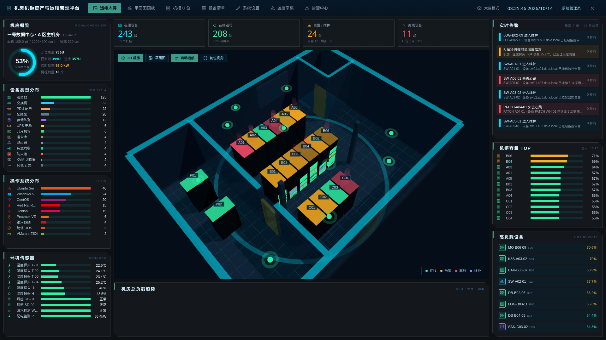
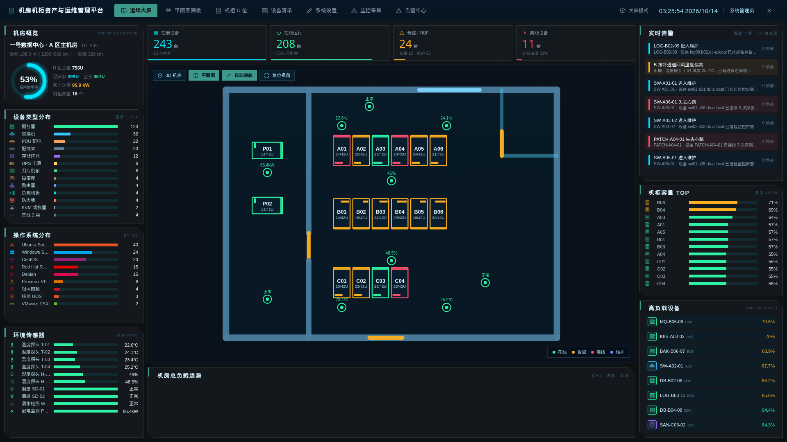
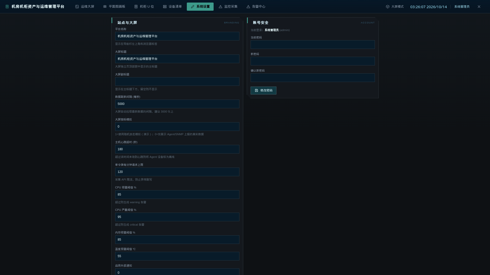

<div align="center">

# 🛡️ RackSentinel

### Data Center Infrastructure & Rack Asset Management

**机房资产与运维管理平台 · Data Center Infrastructure Management**

自绘机房平面图 · 机柜 U 位资产管理 · 运维状态可视化 · 真实监控采集

<br />

[](https://github.com/Viecent-magiclight/RackSentinel-DCIM/releases/tag/v0.2.0)
[](https://www.php.net/)
[](https://go.dev/)
[](https://www.mysql.com/)
[](https://www.sqlite.org/)
[](#-rest-api)
[](https://threejs.org/)

[简体中文](README.md) | [English](README_EN.md)

[功能特性](#-功能特性) · [快速开始](#-快速开始) · [监控与边缘组件](#-监控与边缘组件) · [技术架构](#-技术架构) · [路线图](#-路线图)

</div>

---

## 📖 项目简介

**RackSentinel** 是面向数据中心机房的资产与运维管理平台：平面图与机柜 DCIM、运维大屏，以及 **v0.2** 起的真实监控数据通路（采集 API、主机 Agent、SNMP 轮询、腾讯云告警通知）。

Web 端采用 **纯 PHP + PDO + 原生 JavaScript**（无 Composer、无前端构建）；边缘组件为 **Go 单文件二进制**。数据库支持 MySQL 与 SQLite。

> **当前正式版本：[v0.2.0](https://github.com/Viecent-magiclight/RackSentinel-DCIM/releases/tag/v0.2.0)**
>
> - 在 Web「**监控采集**」页关闭「大屏指标模拟」（`metrics_simulation=0`）后，大屏展示 Agent / SNMP **上报的真实指标**。
> - 仍可选择开启模拟（`metrics_simulation=1`）用于演示。
> - SNMP 厂商配置中标记 **`needs_verification`** 的 OID 需在现场设备上核对。

应用代码位于仓库子目录 **`RackSentinel-DCIM/`**（下文路径均相对于该目录）。

## 🖼️ 界面预览

### 运维大屏 · Operations Dashboard

<p align="center">
  
  
</p>

### 机房平面图设计 · Floor Plan Designer

<p align="center">
  
</p>

### 机柜 U 位编辑 · Rack Layout Editor

<p align="center">
  
</p>

### 资产管理 · Asset Management

<p align="center">
  
</p>

### 系统设置 · Settings

<p align="center">
  
</p>

### 监控采集 · Monitoring ingest（v0.2）

<p align="center">
  
</p>

### 告警中心 · Alerts

<p align="center">
  
</p>

### 设备监控详情 · Device monitor

<p align="center">
  
</p>

> 截图均为 **v0.2** 当前 UI（1920×1080），存放于仓库根目录 [`Preview/`](./Preview)。维护者可运行 `install/cli.php` 后执行 `scripts/prep-screenshot-demo.php` 与 `node scripts/capture-previews.mjs` 重新生成。

## ✨ 功能特性

| 功能模块 | 能力说明 |
| --- | --- |
| 🖥️ **运维大屏** | 3D / 平面图、设备状态、U 位与功率、告警与负载趋势；支持真实指标或演示模拟 |
| ✏️ **平面图设计器** | 墙体、门窗、柱、机柜、环境传感器；网格吸附、撤销重做 |
| 📐 **机柜 U 位管理** | 42U 立面、拖放改 U 位 / 跨柜搬迁；SNMP 与监控字段 |
| 🔍 **设备清单** | 搜索、筛选、Excel 导入导出 |
| 📡 **采集 API** | `api/ingest.php`：令牌鉴权、心跳 / 指标 / 健康 / 告警、SNMP 上报（见 [INGEST_API.md](RackSentinel-DCIM/docs/INGEST_API.md)） |
| 🖧 **主机 Agent** | Linux / macOS / Windows 采集 CPU、内存、磁盘、网络；离线缓冲 |
| 🔀 **SNMP 轮询器** | IF-MIB、多 CPU、ENTITY-SENSOR、UPS-MIB；`sysObjectID` 匹配厂商 JSON 配置 |
| 📞 **告警通知器** | 拉取未确认告警，腾讯云 **短信** 与 **语音**（TC3 签名） |
| 🛎️ **监控采集 / 告警中心** | `monitor.php` 管理令牌与腾讯云设置；`alerts.php`、`device-monitor.php` |
| ⚙️ **系统设置** | 站点名称、大屏标题、刷新间隔、账号密码 |

**支持的设备类型**：服务器、交换机、路由器、防火墙、存储、UPS、PDU、KVM 等（见 `lib/catalog.php`）。

## 🧰 技术栈

| 层级 | 技术 |
| --- | --- |
| Web 后端 | PHP 8.0+、PDO、REST 单入口 |
| 数据库 | MySQL 5.7+/8.0 或 SQLite |
| Web 前端 | 原生 JavaScript、Three.js（CDN） |
| 边缘组件 | Go 1.22+（host / snmp / notifier） |
| Excel | 纯 PHP XLSX 库 |

## 🚀 快速开始

### 环境要求

- PHP **8.0+**（`pdo_mysql` 或 `pdo_sqlite`）
- 可选：Go 1.22+（仅当自行编译 Agent 时）
- Web 服务器或 `php -S`

### 1. 获取代码

```bash
git clone https://github.com/Viecent-magiclight/RackSentinel-DCIM.git
cd RackSentinel-DCIM/RackSentinel-DCIM
```

### 2. 配置数据库

编辑 `config/config.php`，或使用环境变量 `RACK_DB_DRIVER=sqlite` 快速体验（见下文）。

### 3. 安装

浏览器访问 `install.php`，或：

```bash
php install/cli.php
```

### 4. 启动

```bash
php -S 127.0.0.1:8123 -t .
```

默认管理员：`admin` / `admin123`（安装后请修改密码）。

### SQLite 快速体验

```bash
RACK_DB_DRIVER=sqlite php install/cli.php
RACK_DB_DRIVER=sqlite php -S 127.0.0.1:8123 -t .
```

数据文件：`storage/server_rack.sqlite`。

---

## 📡 监控与边缘组件

详细部署说明见 **[docs/DEPLOYMENT.md](RackSentinel-DCIM/docs/DEPLOYMENT.md)**。采集 HTTP 契约见 **[docs/INGEST_API.md](RackSentinel-DCIM/docs/INGEST_API.md)**。

预编译二进制：[GitHub Release v0.2.0](https://github.com/Viecent-magiclight/RackSentinel-DCIM/releases/tag/v0.2.0)（`racksentinel-host-*`、`racksentinel-snmp-*`、`racksentinel-notifier-*`，含 linux/darwin/windows × amd64/arm64；SNMP 另附 `racksentinel-snmp-profiles-v0.2.0.tar.gz`）。

自行打包：

```bash
cd agents && ./release-build.sh /path/to/output v0.2.0
```

### Web：创建采集令牌

1. 登录后打开 **监控采集**（`monitor.php`）。
2. 关闭「大屏指标模拟」并保存（写入 `metrics_simulation=0`）。
3. 按需创建令牌（**完整令牌仅显示一次**，请妥善保存）：
   - **+ 主机 Agent**：须选择绑定设备；用于 `ingest:device`。
   - **+ SNMP 轮询器令牌**：`snmp_poller`，用于拉取 SNMP 目标并上报。
   - **+ 通知器令牌**：`notifier`，用于拉取告警列表。

`server_url` 应指向：`https://<你的域名>/<路径>/api/ingest.php`（无尾部斜杠）。

---

### 1️⃣ 主机 Agent（`racksentinel-host`）

#### 下载与配置

1. 从 [v0.2.0 Release](https://github.com/Viecent-magiclight/RackSentinel-DCIM/releases/tag/v0.2.0) 下载对应平台的 `racksentinel-host-<os>-<arch>`（Windows 为 `.exe`）。
2. 复制 `agents/host/config.example.json` 为 `config.json`（或与二进制同目录）。

| 字段 | 说明 |
| --- | --- |
| `server_url` | 采集 API 基址，例如 `https://dcim.example.com/api/ingest.php` |
| `token` | 主机 Agent 令牌（创建时一次性显示） |
| `interval_sec` | 上报间隔（秒），默认 `60` |
| `buffer_file` | 离线队列文件，默认 `buffer.json` |

环境变量（可覆盖配置）：`RACK_INGEST_URL`、`RACK_AGENT_TOKEN`、`RACK_AGENT_CONFIG`（配置文件路径）。

#### Linux（systemd）

```bash
sudo cp racksentinel-host-linux-amd64 /usr/local/bin/racksentinel-host
sudo mkdir -p /etc/racksentinel
sudo cp config.json /etc/racksentinel/host-config.json
sudo bash agents/host/scripts/install-linux.sh
sudo systemctl start racksentinel-host
sudo systemctl status racksentinel-host
```

**卸载**：`sudo systemctl disable --now racksentinel-host`；删除 `/etc/systemd/system/racksentinel-host.service` 后 `systemctl daemon-reload`。

#### macOS（launchd）

```bash
sudo cp racksentinel-host-darwin-arm64 /usr/local/bin/racksentinel-host
sudo cp config.json /usr/local/etc/racksentinel/host-config.json
sudo bash agents/host/scripts/install-macos.sh /usr/local/bin/racksentinel-host /usr/local/etc/racksentinel/host-config.json
```

**卸载**：`sudo launchctl unload /Library/LaunchDaemons/com.racksentinel.host.plist` 并删除 plist。

#### Windows（服务）

```powershell
# 将 racksentinel-host-windows-amd64.exe 与 config.json 放到例如 C:\Program Files\RackSentinel\
.\agents\host\scripts\install-windows.ps1 -Binary "C:\Program Files\RackSentinel\racksentinel-host.exe" -Config "C:\ProgramData\RackSentinel\host-config.json"
sc.exe start RackSentinelHost
```

服务使用 `-service -config <path>` 运行（见 `agents/host/service_windows.go`）。

**卸载**：`sc.exe stop RackSentinelHost`；`sc.exe delete RackSentinelHost`。

#### 离线缓冲与排障

- 上报失败时，心跳与指标写入 `buffer_file`，恢复连通后自动重试。
- 单次测试：`racksentinel-host -config config.json -once`。
- 设备长时间离线：检查「监控采集」中 **心跳超时**（`heartbeat_stale_sec`）与设备 `monitor_mode=agent`。
- HTTP 401：令牌错误或已禁用；403：令牌未绑定设备。

---

### 2️⃣ SNMP 轮询器（`racksentinel-snmp`）

#### 令牌与配置

1. 在 **监控采集** 创建 **SNMP 轮询器令牌**。
2. 配置 `agents/snmp/config.example.json`：

| 字段 | 说明 |
| --- | --- |
| `server_url` | 同上，指向 `api/ingest.php` |
| `token` | SNMP 轮询器令牌 |
| `interval_sec` | 轮询间隔，默认 `120` |
| `profiles_dir` | MIB 配置目录，默认 `profiles`（Release 包请解压 `racksentinel-snmp-profiles-*.tar.gz`） |
| `state_file` | 接口速率计数快照，默认 `snmp-state.json` |

运行：`racksentinel-snmp -config config.json`；单次：` -once`。

命令行探测（无需 Web 会话）：`racksentinel-snmp -probe -host 10.0.0.1 -community public -version 2c`

#### Web：添加 SNMP 设备

在 **机柜 U 位** 编辑设备：

| 字段 | 说明 |
| --- | --- |
| `monitor_mode` | 设为 **`snmp`** |
| `snmp_enabled` | **是** |
| `snmp_version` | `1` / `2c` / `3` |
| `snmp_host` | 留空则使用管理 IP / 业务 IP |
| `snmp_port` | 默认 `161` |
| `snmp_community` | v1/v2c Community |
| `snmp_v3_user` / `snmp_v3_auth_proto` / `snmp_v3_auth_pass` / `snmp_v3_priv_proto` / `snmp_v3_priv_pass` | SNMPv3 |
| `snmp_profile` | 可选厂商配置 ID；留空则根据 **sysObjectID 前缀** 自动匹配 |

点击 **测试 SNMP 连接**（调用本机 `racksentinel-snmp -probe`，需在服务器上安装二进制）。

监控详情见 `device-monitor.php?id=<设备ID>`（接口、传感器、指标趋势）。

#### 厂商配置（`agents/snmp/profiles/*.json`）

| 配置 ID | 厂商 / 场景 | 现场核对 |
| --- | --- | --- |
| `generic-host-resources` | 标准 HOST-RESOURCES / IF-MIB | 部分需核对 |
| `generic-ups` | RFC1628 UPS-MIB | 否 |
| `cisco-ios` | Cisco CPU / 内存 / 温度 | **needs_verification** |
| `huawei-switch` | 华为交换机 | **needs_verification** |
| `h3c-switch` | H3C HH3C-ENTITY-EXT | **needs_verification** |
| `brocade-fc` | Brocade / Broadcom SAN | **needs_verification** |
| `dell-emc-unity` | Dell EMC Unity | **needs_verification** |
| `hpe-3par` | HPE 3PAR / Primera | **needs_verification** |
| `huawei-oceanstor` | 华为 OceanStor | **needs_verification** |
| `netapp-ontap` | NetApp ONTAP | **needs_verification** |
| `synology-dsm` | Synology | **needs_verification** |
| `qnap-qts` | QNAP | **needs_verification** |
| `ibm-storwize` | IBM Storwize / FlashSystem | **needs_verification** |
| `hitachi-storage` | Hitachi | **needs_verification** |

#### 以服务运行（示例：Linux systemd）

可参考主机 Agent 编写 unit：`ExecStart=/usr/local/bin/racksentinel-snmp -config /etc/racksentinel/snmp-config.json`，`Restart=always`。

---

### 3️⃣ 告警通知器（`racksentinel-notifier`）

#### 平台侧（Web）

在 **监控采集** → **告警通知（腾讯云）**：

| 设置项（`settings` 键） | 说明 |
| --- | --- |
| `notify_enabled` | `1` 启用（通知器仍建议以环境变量提供密钥） |
| `tencent_secret_id` / `tencent_secret_key` | 可留空，改用环境变量 |
| `tencent_sms_app_id` / `tencent_sms_sign` / `tencent_sms_template_id` | 短信 |
| `tencent_vms_app_id` / `tencent_vms_template_id` | 语音 |
| `notify_dedupe_sec` | 去重间隔（秒） |
| `notify_rate_per_hour` | 每小时最大外呼次数 |
| `notify_voice_mode` | `tts`（SendTtsVoice）或 `code`（SendCodeVoice） |

**收件人**：同一页面添加；字段包括 `phone`（语音）、`sms_phone`、`min_level`（`info`/`warning`/`critical`）、`escalate_min`（告警创建后多少分钟才通知）。

**测试发送**：保存配置后点击 **测试发送**（调用 `notify.test_send` API，需有效腾讯云模板与签名）。

环境变量（推荐，勿写入仓库）：`TENCENT_SECRET_ID`、`TENCENT_SECRET_KEY`。

#### 通知器进程配置

复制 `agents/notifier/config.example.json`：

| 字段 | 说明 |
| --- | --- |
| `server_url` / `token` | 指向 `api/ingest.php` 与 **通知器令牌** |
| `interval_sec` | 轮询间隔 |
| `secret_id` / `secret_key` | 可留空，使用环境变量 |
| `sms_sdk_app_id` / `sms_sign` / `sms_template_id` | 短信（与 Web 设置一致） |
| `vms_sdk_app_id` / `vms_template_id` | 语音 |
| `dedupe_sec` / `rate_per_hour` / `voice_mode` | 去重、限流、语音模式 |

CLI 测试（需 `TEST_PHONE`）：`TEST_PHONE=+86... racksentinel-notifier -config config.json -test`

行为概要：拉取 `alerts.pending` 与 `notify.recipients`；按级别与 `escalate_min` 过滤；去重与每小时限流；成功后可通过 `alerts.ack_remote` 确认（实现见 `agents/notifier`）。

---

## 🏗️ 技术架构

```text
┌─────────────────────────────────────────────────────────────────┐
│  Web UI：大屏 · 平面图 · 机柜 · 清单 · 监控采集 · 告警中心        │
└────────────────────────────┬────────────────────────────────────┘
                             │
        ┌────────────────────┼────────────────────┐
        │                    │                    │
        ▼                    ▼                    ▼
 api/index.php        api/ingest.php         install/
 (会话 REST)          (Bearer 令牌)           migrate
        │                    │
        └──────────┬─────────┘
                   ▼
            PHP + PDO (lib/*)
                   │
                   ▼
     MySQL / SQLite：devices · device_metrics · device_interfaces
                      · device_sensors · monitor_agents · alerts · …
                   ▲
     ┌─────────────┴─────────────┬──────────────────┐
     │                           │                  │
 racksentinel-host      racksentinel-snmp    racksentinel-notifier
 (主机指标)              (SNMP 轮询)           (腾讯云语音/短信)
```

### 核心数据关系

- `devices`：资产与 `monitor_mode`（`none` / `agent` / `snmp`）、SNMP 字段、`last_heartbeat_at`
- `device_metrics` / `device_interfaces` / `device_sensors`：上报指标与 SNMP 详情
- `monitor_agents`：采集令牌（哈希存储）
- `alerts` / `notification_recipients`：告警与外呼收件人

## 🔌 REST API

**管理面**（需登录会话）：

```text
RackSentinel-DCIM/api/index.php?r=<resource>.<action>
```

**采集面**（Bearer 令牌，无需浏览器 Cookie）：

```text
RackSentinel-DCIM/api/ingest.php?r=<action>
```

常用路由：`dashboard.summary`、`metrics.tick`（`metrics_simulation=0` 时仅回读真实指标）、`device.monitor`、`device.snmp_test`、`agent.*`、`notify.*`。

完整采集契约：[docs/INGEST_API.md](RackSentinel-DCIM/docs/INGEST_API.md)。

## 🔐 安全设计

- bcrypt 密码、登录 IP 限速、会话 HttpOnly / SameSite、写入同源校验、PDO 预处理、字段白名单。
- **切勿**将腾讯云 SecretKey 或采集令牌提交到 Git；优先使用环境变量。

## 🗺️ 路线图

### v0.2（已发布）

- [x] 采集 API、主机 / SNMP / 通知器、监控 UI、IF-MIB 与厂商配置框架

### 后续

- [ ] 多机房聚合、Zabbix/Prometheus 适配、更完整的 FC 端口级指标
- [ ] 更多厂商 MIB 现场验证与自动发现
- [ ] RBAC、邮件 / 企业微信 / Webhook、3D 资源离线化

## 📁 目录结构

```text
RackSentinel-DCIM/
  api/index.php · api/ingest.php
  monitor.php · alerts.php · device-monitor.php
  docs/INGEST_API.md · docs/DEPLOYMENT.md
  agents/host · agents/snmp · agents/notifier · agents/release-build.sh
  lib/ingest.php · lib/ingest_snmp.php
  install/ · assets/ · config/
Preview/                 # 仓库根目录截图
```

## 📝 注意事项

- 大屏默认 `poll_ms` 轮询；历史指标写入有节流（见 `metrics.tick`）。
- 3D 依赖 Three.js CDN，失败时回退平面图。
- U 位：U1 在机柜底部向上递增。

## 📄 License

[MIT License](./LICENSE)

---

<div align="center">

**RackSentinel · 让每一 U 空间一目了然**

*Every rack unit, crystal clear.*

</div>
